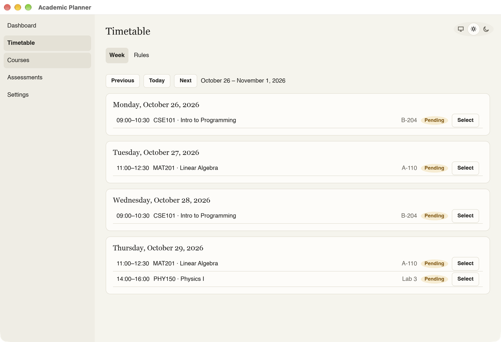
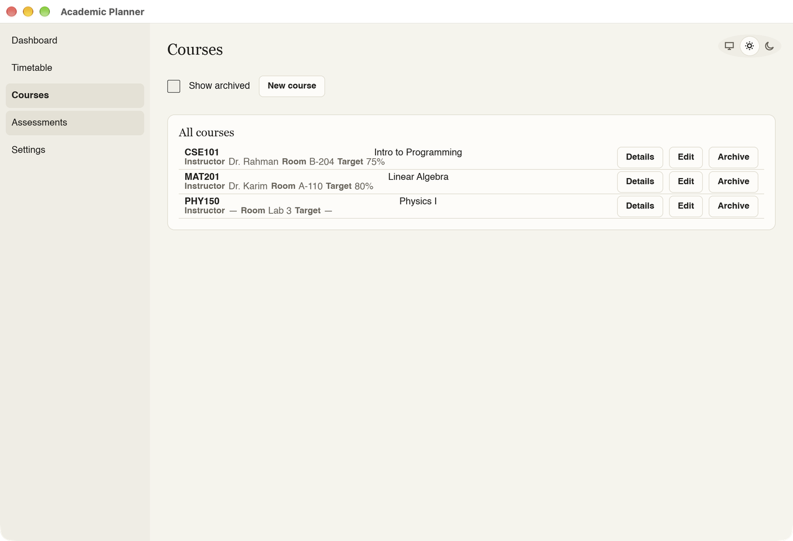
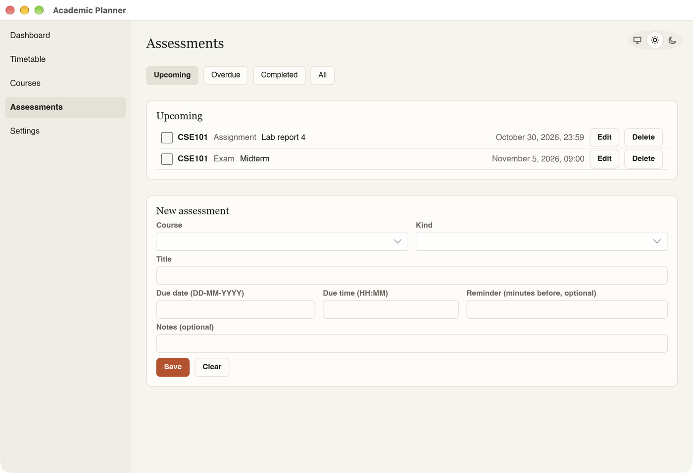
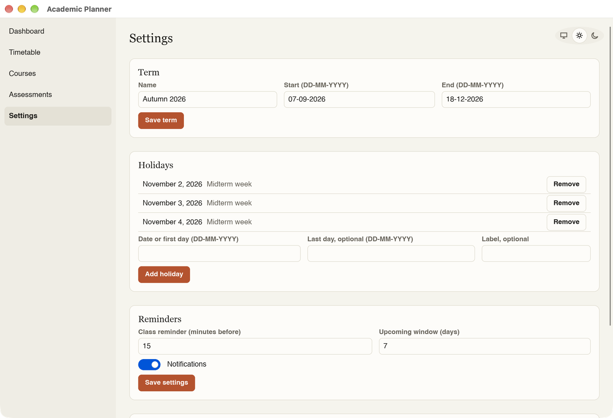

# Academic Planner

Academic Planner is a local-first, open-source desktop app for university courses, weekly
timetables, assessments, and manually logged attendance. It has a native user interface built with
Slint (no WebView), needs no account and no server, and keeps all your data in one file on your own
computer. You enter your term, holidays, courses, and weekly class times; the app fills in the
term's classes, you mark each one as attended, absent, or cancelled, and it shows your attendance
percentage per course and which courses are below your target. While the app is open, it can show
a desktop notification before each class and before assessments that have a reminder set.

## Screenshots










## Download and install

Download the file for your system from the
[Releases page](https://github.com/sahil0319/Academic-Planner/releases).

### macOS (Apple Silicon)

1. Download the file ending in `_aarch64.dmg`, open it, and drag "Academic Planner" to the
   Applications folder.
2. The app is not signed by Apple, so macOS blocks the first launch. To allow it:
   - macOS 15 and later: try to open the app once, then open System Settings → Privacy & Security,
     scroll down, and click "Open Anyway" next to the message about Academic Planner.
   - Older macOS: right-click (or Control-click) the app in Applications and choose Open, then
     confirm with Open.
   - If neither works, run this in Terminal:

     ```sh
     xattr -dr com.apple.quarantine "/Applications/Academic Planner.app"
     ```

   You only need to do this once.

The `.dmg` is built for Apple Silicon (M-series) Macs. On an Intel Mac, build the app from source
(see below).

### Windows

1. Download and run `academic-planner_<version>_x64-setup.exe`.
2. The installer is not signed, so Microsoft Defender SmartScreen may warn you. Click "More info",
   then "Run anyway".

The installer adds Academic Planner to the Start menu and registers an uninstaller.

### Linux

On Debian, Ubuntu, and related distributions, install the `.deb` package:

```sh
sudo apt install ./academic-planner_<version>_amd64.deb
```

Or use the AppImage, which runs without installing:

```sh
chmod +x academic-planner_<version>_x86_64.AppImage
./academic-planner_<version>_x86_64.AppImage
```

## Build from source

1. Install Rust 1.90 or later with [rustup](https://rustup.rs).
2. On Debian or Ubuntu, install the system libraries first:

   ```sh
   sudo apt-get install libfontconfig1-dev libxkbcommon-dev
   ```

3. From the repository root, run the app in debug mode:

   ```sh
   cargo run -p app
   ```

   or build an optimized binary with `cargo build --release -p app`.

To try the app without touching your real data, point it at a throwaway database:

```sh
ACADEMIC_PLANNER_DB=/tmp/academic-planner-dev.sqlite cargo run -p app
```

Before sending a change, run the same checks as CI:

```sh
cargo fmt --check && cargo clippy --workspace --all-targets -- -D warnings && cargo test --workspace
```

The full specification is in [docs/spec.md](docs/spec.md).

## Where your data lives

All data is in one SQLite file, `planner.sqlite`, in your user data folder. It is never stored in
the install folder, so reinstalling or updating the app does not touch it.

| System | Folder |
|---|---|
| macOS | `~/Library/Application Support/Academic-Planner/` |
| Windows | `%APPDATA%\Academic Planner\data\` |
| Linux | `~/.local/share/academicplanner/` (or `$XDG_DATA_HOME/academicplanner/` if set) |

The Settings page shows the exact path of the database file. To use a different database file (for
development and testing), set the `ACADEMIC_PLANNER_DB` environment variable to its path.

## Backup, restore, and export

On the Settings page, "Backup…" saves all your data as one JSON file. "Restore…" opens a backup and,
after you confirm with "Replace all data", replaces all current data with it; before it does, the
app copies the current database to `backups/pre-restore-YYYYMMDD-HHMM.sqlite` in the folder that
holds the database, and if the restore fails your data is left unchanged. "Export CSV…" writes
`attendance.csv` and `assessments.csv` to a folder you choose, for use in a spreadsheet app.

## License

Academic Planner is free software, licensed under the GNU General Public License, version 3 or
(at your option) any later version (GPL-3.0-or-later); see [LICENSE](LICENSE). It uses
[Slint](https://slint.dev) under the GPL-3.0-only license option; see [NOTICE](NOTICE).

The licenses of the third-party Rust crates compiled into the app are listed in
`THIRD-PARTY-NOTICES.html`, which is bundled in every installer and attached to each GitHub release.
To generate it yourself, use the command given in [NOTICE](NOTICE).
