# Academic Planner

Academic Planner is a local-first, open-source desktop app for university courses, weekly
timetables, assessments, and manually logged attendance. It has a native user interface built with
Slint (no WebView). It needs no account and no server, and it keeps all your data in one file on
your own computer.

What's new in each version is in the [release notes](docs/releases/). To install the app, see
[Download and install](#download-and-install).

[Features](#features) | [Getting started](#getting-started) | [Screenshots](#screenshots) |
[Download and install](#download-and-install) | [Updates](#updates) |
[Your data](#where-your-data-lives) | [Privacy](#privacy-and-network-use) |
[Build from source](#build-from-source) | [License](#license)

## Features

**Timetable and attendance**
- Enter your weekly class times. The app fills in the term's classes for you.
- Classes can meet every other week. "Move to next week" shifts one occurrence.
- Mark each class as attended, absent, or cancelled, or reschedule it. You can also add makeup classes.
- See your attendance percentage per course against your target, and how many classes you can still miss.
- A banner on the dashboard lists courses that are below their target.

**Courses and grading**
- Give each course credits and a rule set. A rule set has weighted components and attendance bands, with a default attendance scale.
- Enter marks for assessments. The app shows your projected grade and your term GPA.
- For each grade, see the score you need in the final.
- Edit the grade scale on the Rules page.

**Terms and days off**
- Set up a term. The dashboard shows the term and its current week, for example "Week 3 of 17".
- Archive a finished term. It moves to the Past terms list with its attendance and GPA.
- Add holidays, mid exam periods, and final exam periods. Classes are skipped on those days.
- Load your country's public holidays from Google's public holiday calendar and choose which ones to add.

**Progress page**
- One card per course: attendance against target, classes you can still miss, marks, and projected grade.
- Courses at risk are listed first.

**Reminders**
- Desktop notifications before classes and before assessments that have a reminder set.
- They appear only while the app is open.

**Import, export, and backup**
- Import courses and a weekly timetable from JSON. A template and an AI prompt are in [docs/import](docs/import/).
- Export your courses and timetable to JSON (Copy JSON or Save JSON) to share with another person.
- Back up all your data to one JSON file and restore it later.
- Export attendance and assessments to CSV for a spreadsheet app.

**Look and feel**
- Light, dark, or system appearance, from a switch in the top-right corner.
- IBM Plex Sans text and 12-hour times (type `930` and choose PM).
- Type dates as DD-MM-YYYY. They are shown as "October 26, 2026".
- A short pop-up confirms saving, adding, importing, and deleting.
- The About page checks for and installs updates.

## Getting started

1. Install the app (see [Download and install](#download-and-install)) and open it.
2. Go to **Settings** and create your term: a name, a start date, and an end date.
3. Add your holidays and exam periods in Settings, if you know them.
4. Go to **Courses** and add your courses, or use **Import** to set up a whole semester from JSON.
5. Add the weekly class times for each course. The timetable fills in for the term.
6. As classes happen, mark each one on the **Dashboard** or **Timetable** as attended, absent, or cancelled.
7. Check **Progress** to see how each course is going. Set your grading rules on the **Rules** page.

## Screenshots

Every page comes in a light and a dark appearance; switch with the control in the top-right corner.

| | Light | Dark |
| --- | --- | --- |
| **Dashboard** | 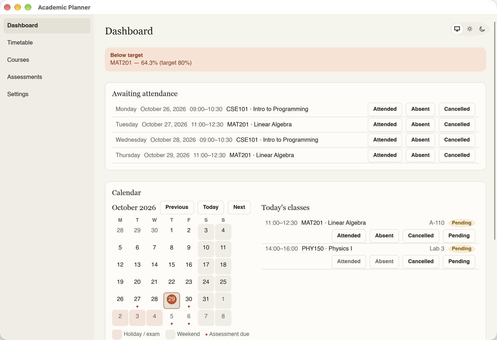 | 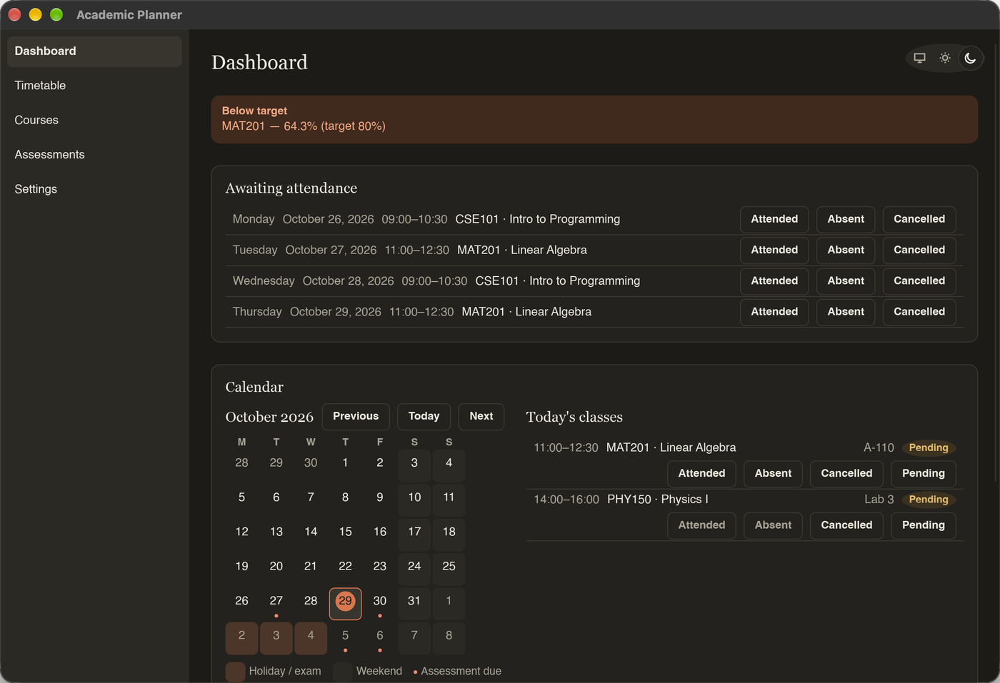 |
| **Progress** | 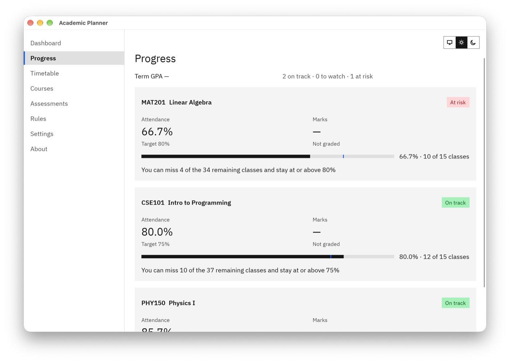 | 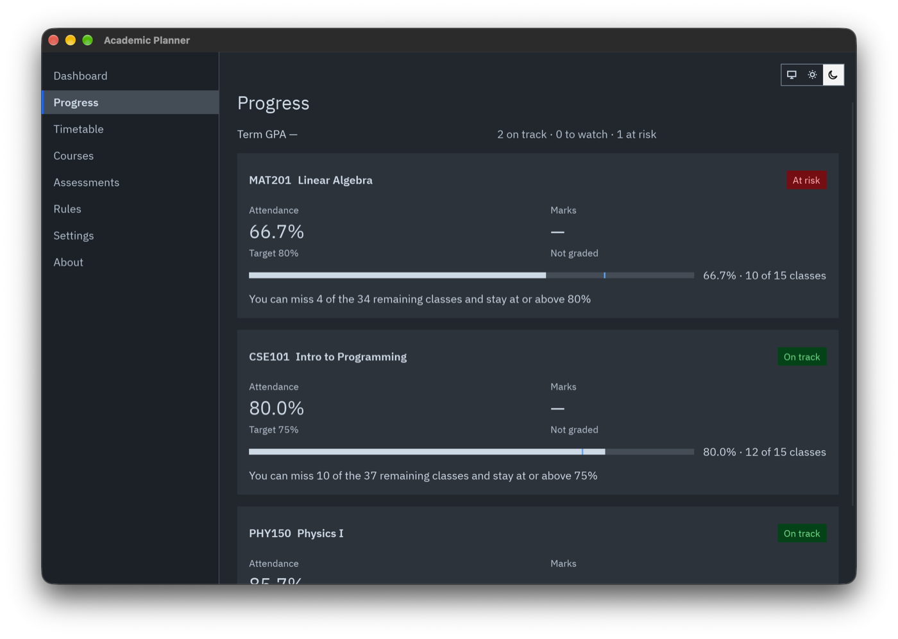 |
| **Timetable** | 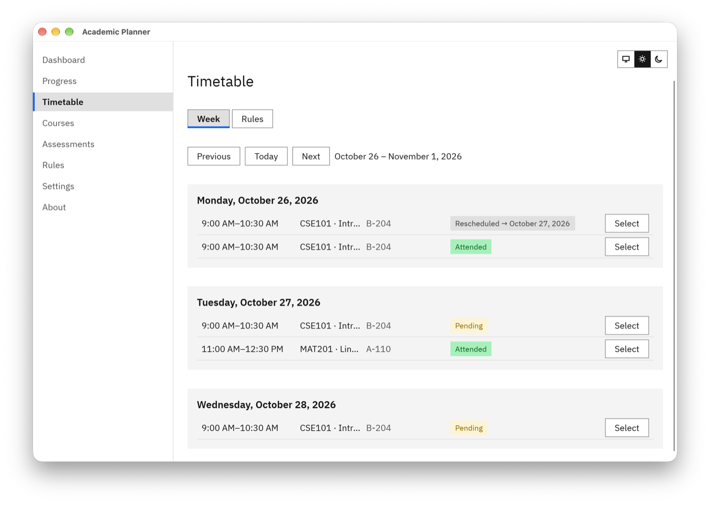 | 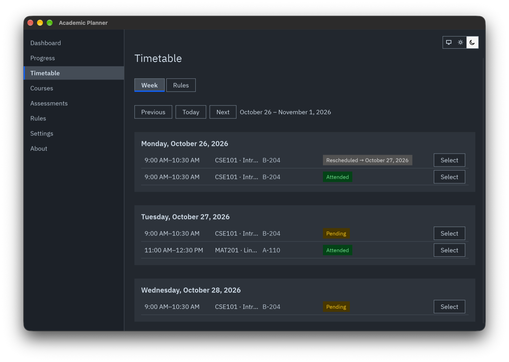 |
| **Courses** | 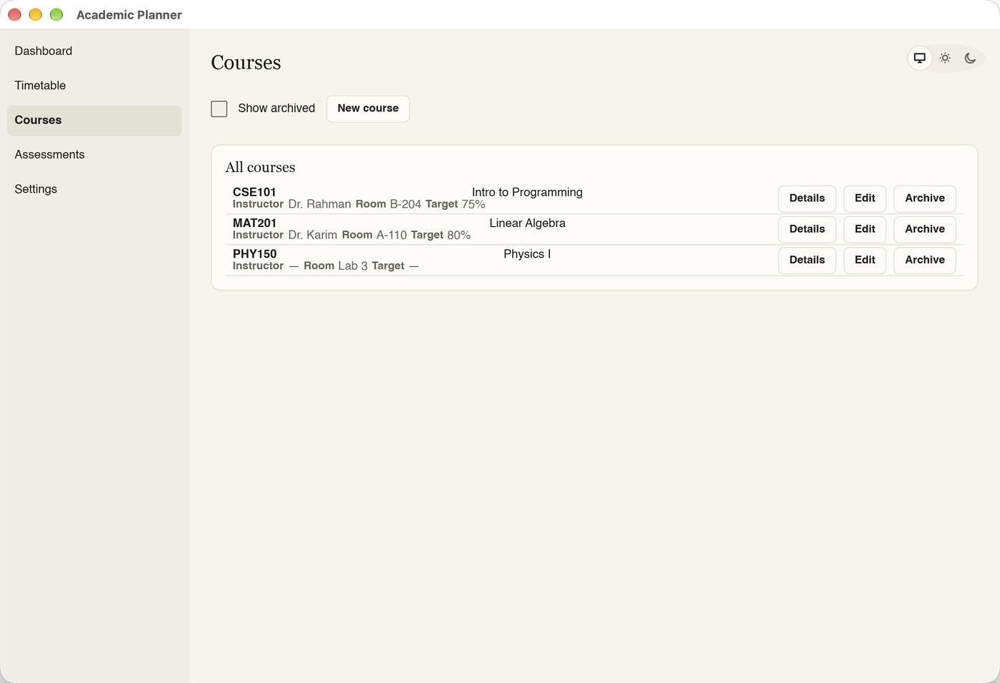 | 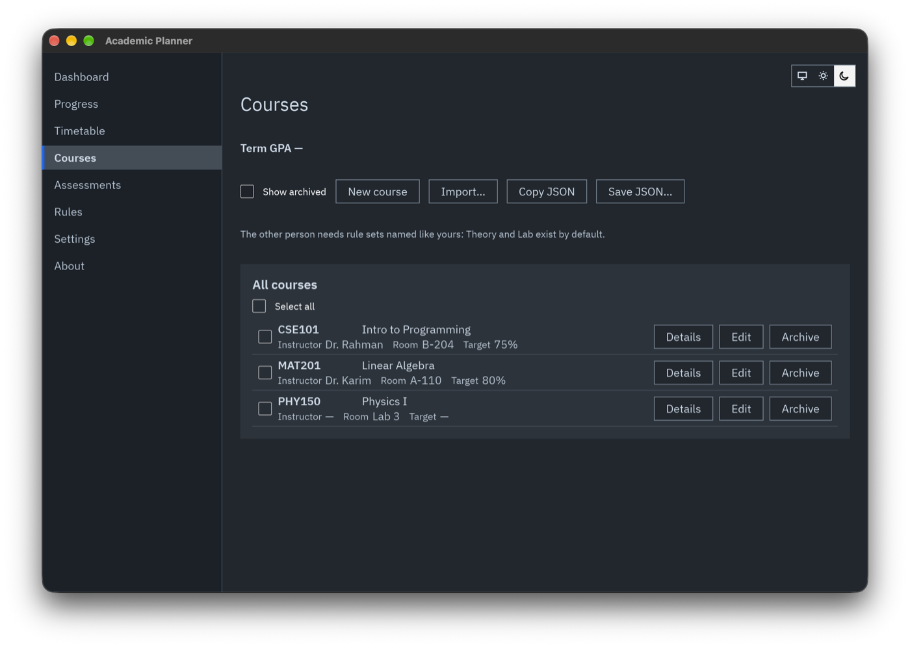 |
| **Assessments** | 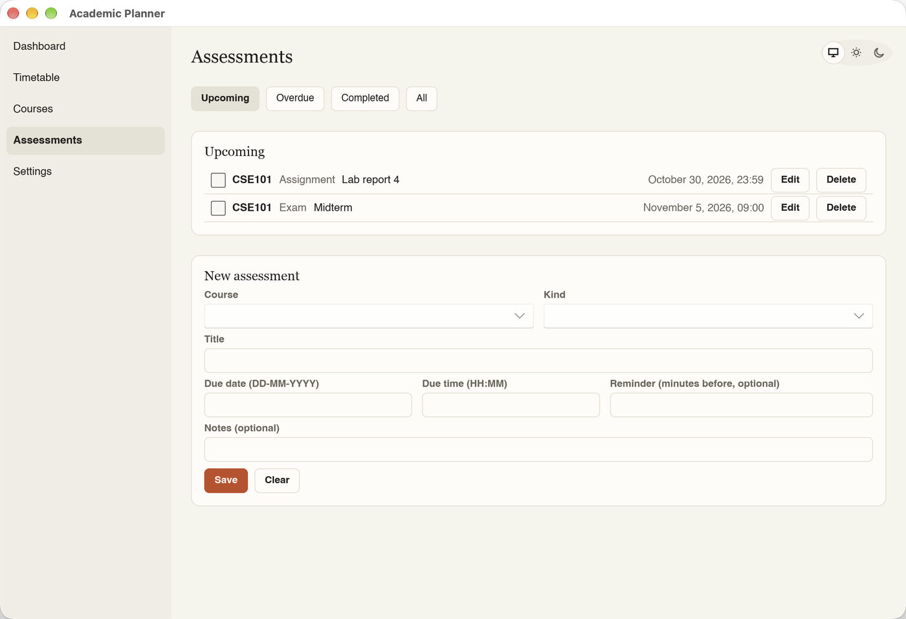 | 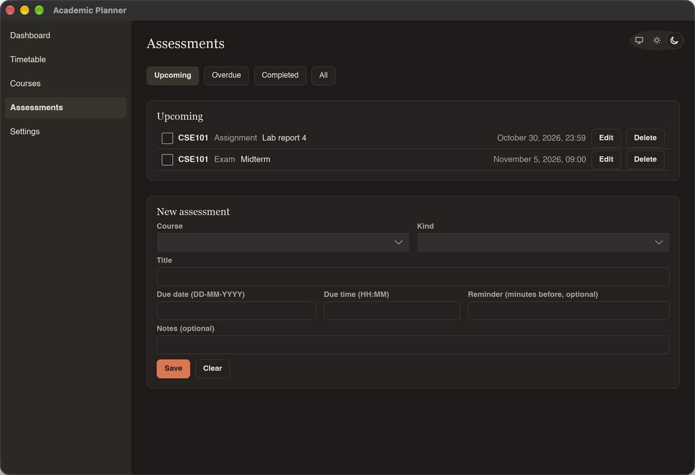 |
| **Rules** | 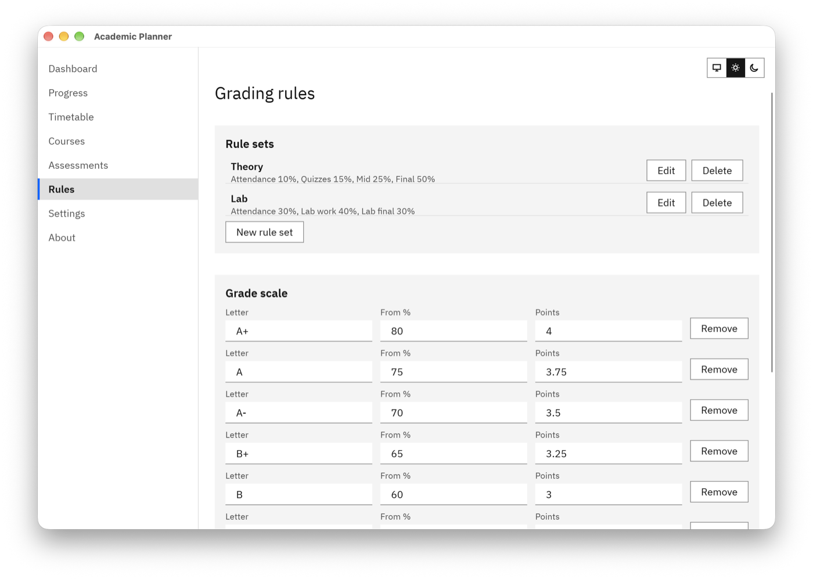 | 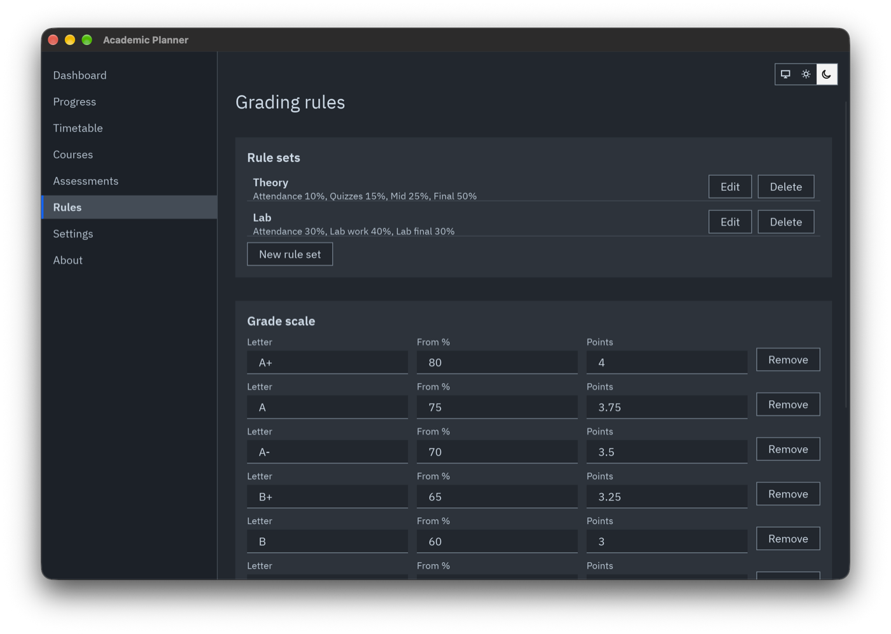 |
| **Settings** | 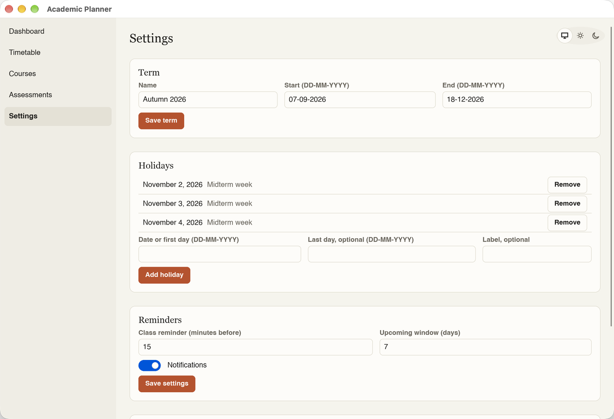 | 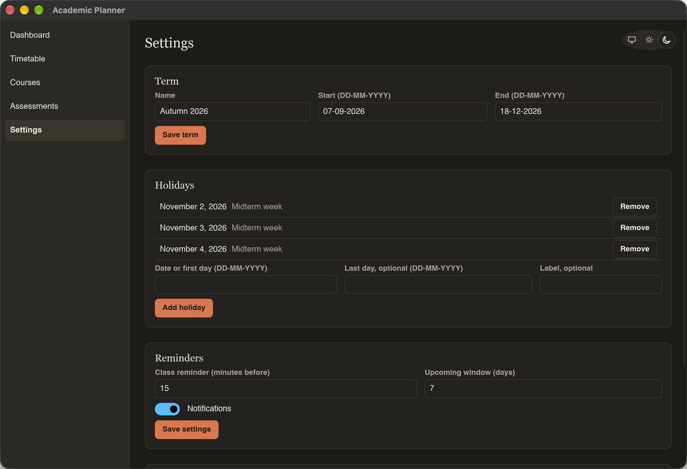 |

## Download and install

Download the file for your system from the
[Releases page](https://github.com/sahil0319/Academic-Planner/releases).

### macOS (Apple Silicon)

1. Download the file ending in `_aarch64.dmg`, open it, and drag "Academic Planner" to the
   Applications folder.
2. The app is not signed by Apple, so macOS blocks the first launch. To allow it:
   - If macOS says "Academic Planner.app is damaged and can't be opened", the app is not damaged.
     Click Cancel (not Move to Trash), then run this in Terminal:

     ```sh
     xattr -dr com.apple.quarantine "/Applications/Academic Planner.app"
     ```

   - If macOS says it cannot verify the developer, on macOS 15 and later open System Settings →
     Privacy & Security, scroll down, and click "Open Anyway" next to the message about Academic
     Planner. On older macOS, right-click (or Control-click) the app in Applications, choose Open,
     and confirm with Open. If that does not work, run the Terminal command above.

   You only need to do this once.

The `.dmg` is built for Apple Silicon (M-series) Macs. On an Intel Mac, build the app from source
(see below).

### Windows

1. Download and run `academic-planner_<version>_x64-setup.exe`.
2. The installer is not signed, so Microsoft Defender SmartScreen may warn you. Click "More info",
   then "Run anyway".

The installer adds Academic Planner to the Start menu and registers an uninstaller.

### Linux

On Debian, Ubuntu, and related distributions, install the `.deb` package:

```sh
sudo apt install ./academic-planner_<version>_amd64.deb
```

Or use the AppImage, which runs without installing:

```sh
chmod +x academic-planner_<version>_x86_64.AppImage
./academic-planner_<version>_x86_64.AppImage
```

## Updates

Academic Planner checks GitHub Releases for a newer published version: once when it starts, if
"Check for updates when the app starts" is on (About page, on by default), or when you click
"Check for updates" on the About page. Nothing is downloaded or installed until you click
"Install" and confirm. Every update is signature-checked before it is installed, and updating
never changes your data. Installs from the `.deb` package (and builds run from source) open the
release page instead, so you can download the new version yourself. See also
[Privacy and network use](#privacy-and-network-use).

## Where your data lives

All data is in one SQLite file, `planner.sqlite`, in your user data folder. It is never stored in
the install folder, so reinstalling or updating the app does not touch it.

| System | Folder |
|---|---|
| macOS | `~/Library/Application Support/Academic-Planner/` |
| Windows | `%APPDATA%\Academic Planner\data\` |
| Linux | `~/.local/share/academicplanner/` (or `$XDG_DATA_HOME/academicplanner/` if set) |

The Settings page shows the exact path of the database file. To use a different database file (for
development and testing), set the `ACADEMIC_PLANNER_DB` environment variable to its path.

## Backup, restore, and export

On the Settings page, "Backup…" saves all your data as one JSON file. "Restore…" opens a backup and,
after you confirm with "Replace all data", replaces all current data with it; before it does, the
app copies the current database to `backups/pre-restore-YYYYMMDD-HHMM.sqlite` in the folder that
holds the database, and if the restore fails your data is left unchanged. "Export CSV…" writes
`attendance.csv` and `assessments.csv` to a folder you choose, for use in a spreadsheet app.

## Privacy and network use

All your data stays on your computer, in one file. The app has no accounts and no analytics.

The app uses the internet in only two cases:

- **Update check.** It asks GitHub Releases for a newer version, once at start-up if "Check for
  updates when the app starts" is on (About page), or when you click "Check for updates". See
  [Updates](#updates).
- **Public holidays.** It loads your country's holidays from Google's public holiday calendar, once
  at start-up and when you change the country. Your country comes from your computer's region
  setting. To turn this off, choose "Off" as the country in Settings. Nothing is loaded if you have
  no active term.

## Build from source

1. Install Rust 1.90 or later with [rustup](https://rustup.rs).
2. On Debian or Ubuntu, install the system libraries first:

   ```sh
   sudo apt-get install libfontconfig1-dev libxkbcommon-dev
   ```

3. From the repository root, run the app in debug mode:

   ```sh
   cargo run -p app
   ```

   or build an optimized binary with `cargo build --release -p app`.

To try the app without touching your real data, point it at a throwaway database:

```sh
ACADEMIC_PLANNER_DB=/tmp/academic-planner-dev.sqlite cargo run -p app
```

Before sending a change, run the same checks as CI:

```sh
cargo fmt --check && cargo clippy --workspace --all-targets -- -D warnings && cargo test --workspace
```

The full specification is in [docs/spec.md](docs/spec.md).

## License

Academic Planner is free software, licensed under the GNU General Public License, version 3 or
(at your option) any later version (GPL-3.0-or-later); see [LICENSE](LICENSE). It uses
[Slint](https://slint.dev) under the GPL-3.0-only license option; see [NOTICE](NOTICE).

The licenses of the third-party Rust crates compiled into the app are listed in
`THIRD-PARTY-NOTICES.html`, which is bundled in every installer and attached to each GitHub release.
To generate it yourself, use the command given in [NOTICE](NOTICE).
